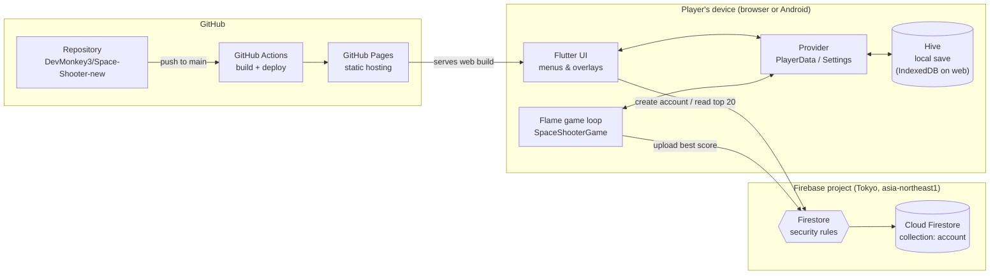
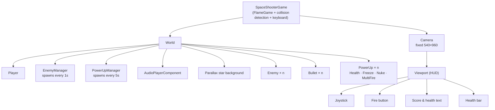
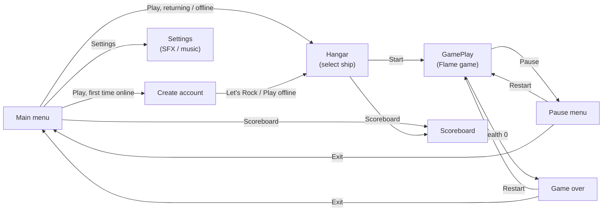
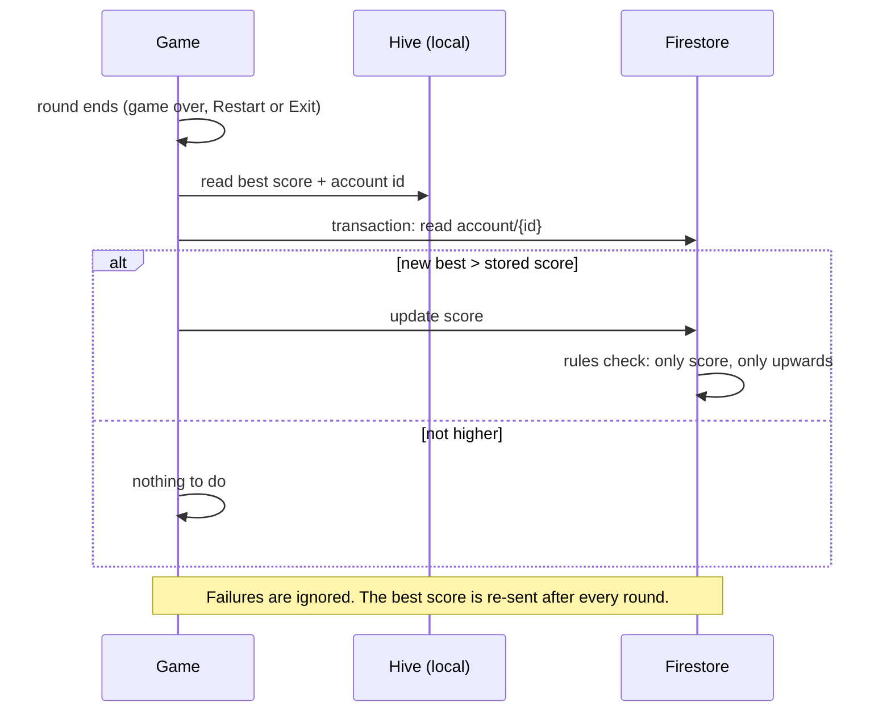
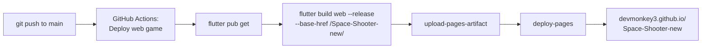

# 🚀 Space Shooter 2400

### ▶ **[Play now in your browser: devmonkey3.github.io/Space-Shooter-new](https://devmonkey3.github.io/Space-Shooter-new/)**

No download, no install. Works on phones (touch) and PCs (mouse or keyboard).

A top-down arcade space shooter built with **Flutter** and the **Flame** game engine,
with an online scoreboard powered by **Firebase Cloud Firestore**, and deployed
automatically to **GitHub Pages** with **GitHub Actions**.

---

## Contents

1. [How to play](#how-to-play)
2. [Tech stack](#tech-stack)
3. [System design](#system-design)
4. [Game architecture](#game-architecture)
5. [Data structures and storage](#data-structures-and-storage)
6. [Online backend (Firebase)](#online-backend-firebase)
7. [Build and deployment](#build-and-deployment)
8. [Project structure](#project-structure)
9. [What changed from the previous version](#what-changed-from-the-previous-version)
10. [Running it locally](#running-it-locally)
11. [Credits and license](#credits-and-license)

---

## How to play

| Action | Touch | Keyboard |
|---|---|---|
| Move | Drag the joystick (bottom left) | `W` `A` `S` `D` |
| Shoot | Tap the fire button (bottom right) | `Space` |
| Pause | Pause button (top) | - |

- Destroy enemies to earn points. Points are also **money** that you spend on new ships in the hangar.
- You lose 10% health every time an enemy rams you. At 0% it's game over.
- Pick a player name the first time you press **Play** to appear on the online **Scoreboard**, or play offline.

**Power-ups** (one spawns every 5 seconds and disappears after 3 seconds):

| Power-up | Effect |
|---|---|
| ➕ Health | +10% health (max 100%) |
| ❄ Freeze | Freezes all enemies and spawning for 2 seconds |
| ☢ Nuke | Destroys every enemy on screen (you get the points) |
| ✳ Multi-fire | Shoots 3 bullets in a spread for 4 seconds |

**Difficulty** rises with your score. The score decides the strongest enemy level that can spawn:

| Score | Max enemy level | Enemy HP |
|---|---|---|
| 0 – 100 | 1 | 10 |
| 101 – 500 | 2 | 20 |
| 501 – 1500 | 3 | 30 |
| 1500+ | 4 | 40 |

**Hangar (8 ships):** a ship's *level* is its bullet damage (level × 10), and *speed* is its movement speed.

| Ship | Cost | Speed | Level |
|---|---|---|---|
| Canary | free | 250 | 1 |
| Dusky | 100 | 400 | 2 |
| Condor | 200 | 300 | 2 |
| CXC | 400 | 300 | 3 |
| Raptor | 550 | 300 | 3 |
| Raptor-X | 700 | 350 | 3 |
| Albatross | 850 | 400 | 4 |
| DK-809 | 1000 | 450 | 4 |

---

## Tech stack

| Layer | Technology | Version | Used for |
|---|---|---|---|
| Language | Dart | 3.13 | All game and app code |
| UI framework | Flutter | 3.47.9 (stable) | Menus, screens, overlays, cross-platform builds |
| Game engine | Flame | 1.38 | Game loop, sprites, collisions, particles, camera, input |
| Audio | flame_audio (audioplayers) | 2.12 | Sound effects and background music |
| State management | provider | 6.1 | Sharing player data and settings across screens |
| Local database | Hive + hive_flutter | 2.2 / 1.1 | Saving money, ships, high score, settings, account id |
| Backend | Firebase Core + Cloud Firestore | 5.1 / 7.1 | Online accounts and the shared scoreboard |
| UI widget | flutter_carousel_slider | 1.1 | Ship picker in the hangar |
| Web hosting | GitHub Pages | - | Hosting the playable web build |
| CI/CD | GitHub Actions | - | Lint + build checks, automatic web deployment |
| Android build | Gradle (Kotlin DSL), Android Gradle Plugin, Kotlin | 9.3 / 9.1 / 2.4 | APK builds (compileSdk 36, minSdk 24 / Android 7.0) |

Targets: **Web** (main public version) and **Android**. The iOS/Windows folders come from
the original template and aren't configured for release.

---

## System design



**Key design decisions**

- **Client-only architecture (no custom server).** The game talks directly to Firestore.
  All protection lives in Firestore **security rules**, which validate every write on
  Google's servers. That keeps hosting free (GitHub Pages + Firebase Spark plan).
- **Offline-first.** Everything that matters to play (money, ships, high score, settings)
  is saved locally in Hive. Firebase is optional: if it can't start, the game runs
  offline, the account screen offers "Play offline", and the scoreboard shows only your
  local best.
- **"Best score only" sync.** The client uploads only the player's best score, inside a
  Firestore **transaction**. The rules additionally reject any score that isn't higher
  than the stored one, so a score can never go down and nobody can lower someone else's.
- **Fixed virtual resolution.** The game world is always 540 × 960 units. Flame's camera
  scales it to fit any screen, so gameplay is identical on every device. On wide screens
  the whole app is shown in a centered 9:16 portrait frame.

---

## Game architecture

The game is a Flame **component tree**. `SpaceShooterGame` owns a `World` (gameplay) and a
`CameraComponent` (view + HUD):



**Patterns and mechanics**

| Concept | How it's done |
|---|---|
| Game loop | Flame calls `update(dt)` on every component each frame. Movement is `position += direction × speed × dt`, so speed is the same at any frame rate. |
| Collisions | `HasCollisionDetection` on the game, `CircleHitbox` on player, enemies, bullets and power-ups, reacting in `onCollision`. |
| Command pattern | Components don't call each other directly. They queue a `Command<T>` (e.g. "add 10 points to the `Player`", "freeze every `Enemy`"). The game runs queued commands on all matching components at the start of the next frame. This decouples power-ups, enemies, audio and the player. |
| Managers + timers | `EnemyManager` and `PowerUpManager` use Flame `Timer`s for spawning, and a second timer to resume after a Freeze. |
| Data-driven enemies | 16 enemy types are rows in a constant `List<EnemyData>` (speed, sprite, level, horizontal movement, points), not separate classes. |
| Sprite sheet | All ships, enemies and bullets come from one 8 × 6 tile sheet (`simpleSpace_tilesheet@2.png`), picked by sprite id. |
| Particles | Engine exhaust and explosions are `ParticleSystemComponent`s of short-lived `AcceleratedParticle`s. |
| Camera shake | A short `MoveByEffect` on the camera viewfinder when the player is hit. HUD elements live in the viewport, so they don't shake. |
| Overlays | Flutter widgets drawn on top of the game (`PauseButton`, `PauseMenu`, `GameOverMenu`), switched with `game.overlays`. |
| Lifecycle | When the app or tab loses focus, the game pauses itself and shows the pause menu. |
| Double-destroy guard | An enemy has an `isDestroyed` flag, so a Nuke and a bullet in the same frame can't award points twice. |

**Screen flow**



---

## Data structures and storage

### Local save (Hive)

Hive stores Dart objects in binary "boxes". Each class has a generated `TypeAdapter`
(`*.g.dart`) that converts it to and from bytes. On Android boxes are files; on the web
they're stored in the browser's **IndexedDB**.

| Box | Key | Type | Fields |
|---|---|---|---|
| `PlayerDataBox` | `PlayerData` | `PlayerData` (typeId 0) | `spaceshipType`, `ownedSpaceships: List<SpaceshipType>`, `highScore: int`, `money: int` |
| `SettingsBox` | `Settings` | `Settings` (typeId 2) | `soundEffects: bool`, `backgroundMusic: bool` |
| `AccountBox` | `accountId` | `String` | the player's Firestore document id |

`SpaceshipType` is a Hive-serialised **enum** (typeId 1) with 8 values.

`PlayerData` and `Settings` extend `ChangeNotifier`. They're provided app-wide with
**Provider**, so when you buy a ship the hangar UI rebuilds automatically, and each
change calls `save()` to write itself back to Hive.

### Static game data (in code)

| Structure | Type | Purpose |
|---|---|---|
| `Spaceship.spaceships` | `Map<SpaceshipType, Spaceship>` | Ship catalog: name, cost, speed, sprite id, image, level |
| `EnemyManager._enemyDataList` | `List<EnemyData>` (16 entries) | Enemy catalog, grouped 4 per level |
| `PowerUpManager._powerUpMap` | `Map<PowerUpTypes, factory fn>` | Picks a random power-up and builds it |

### Online data (Cloud Firestore)

One collection, one document per player:

```
account/                      (collection)
  {auto-generated id}/        (document = one player)
      name:  string           3–16 characters, unique (checked by the app)
      score: int              best score uploaded so far
```

The scoreboard query is `orderBy('score', descending) .limit(20)`, streamed live with
`snapshots()`, so it updates in real time when anyone sets a new best.

---

## Online backend (Firebase)

**Setup used:**

1. Created the Firebase project **SpaceShooter** (`spaceshooter-7781b`) on the free **Spark** plan.
2. Created a **Cloud Firestore** database, **Standard edition**, location **asia-northeast1 (Tokyo)**, started in **production mode** (deny all).
3. Published the security rules below.
4. Registered an **Android app** (`com.example.space_shooter_2400`) and a **Web app** (`Space Shooter 2400 Web`). Their public client config is in `lib/firebase_options.dart`.

**Security rules (the actual protection):**

```js
rules_version = '2';
service cloud.firestore {
  match /databases/{database}/documents {
    match /account/{id} {
      // Anyone can read the scoreboard.
      allow read: if true;

      // New accounts: a 3-16 character name and a starting score of 0.
      allow create: if request.resource.data.keys().hasOnly(['name', 'score'])
                    && request.resource.data.name is string
                    && request.resource.data.name.size() >= 3
                    && request.resource.data.name.size() <= 16
                    && request.resource.data.score == 0;

      // Only the score may change, and only upwards.
      allow update: if request.resource.data.diff(resource.data).affectedKeys().hasOnly(['score'])
                    && request.resource.data.score is int
                    && request.resource.data.score > resource.data.score;

      // Nobody can delete accounts from the app.
      allow delete: if false;
    }
  }
}
```

Tested against the live database: reads are allowed, while fake starting scores, too-short
names, lowering a score, renaming and deleting are all rejected with `403`.

> **About the API keys in the code:** Firebase client keys are *meant* to ship inside apps.
> They only identify the project and aren't secrets. Firestore access is controlled
> entirely by the rules above. GitHub's secret scanner flags them anyway, but that's a false positive.

**Score upload flow:**



---

## Build and deployment

### Web (public version)



- `.github/workflows/deploy-web.yml` builds and publishes on every push to `main`
  (GitHub repo → Settings → Pages → Source: **GitHub Actions**).
- `--base-href` is set to the repository name because a GitHub project site lives in a sub-folder.
- `web/index.html` has a custom **loading screen**, page metadata and link-preview tags.
  `web/flutter_bootstrap.js` starts the Flutter engine and fades the loading screen out
  once the game's first frame is ready.
- `web/manifest.json` makes it installable as a PWA ("Add to Home screen") with the game's own icons.

### Quality check (CI)

`.github/workflows/build.yml` runs on every push and pull request:
`dart format --set-exit-if-changed` → `flutter analyze` → `flutter build apk --release`,
and keeps the APK as a downloadable artifact for 7 days.

### Android

- Gradle **Kotlin DSL** (`build.gradle.kts`), AGP 9.1, Kotlin 2.4, Gradle 9.3, Java 17,
  compileSdk 36, minSdk 24, NDK 28.2.
- Release builds are signed with a private upload key. `android/key.properties` (which
  points to the keystore) is **git-ignored**, and so are all `*.jks` / `*.keystore` files.
  Without it, release builds fall back to the debug key so they still compile.
- `kotlin.incremental=false` in `android/gradle.properties` works around a Kotlin bug on
  Windows when the project and the pub cache are on different drives.

---

## Project structure

```
lib/
├── main.dart                     App entry: Firebase init, Hive init, providers, portrait frame
├── firebase_options.dart         Firebase client config (web + Android)
├── game/                         Flame game
│   ├── game.dart                 SpaceShooterGame: world, camera, HUD, commands, game over, score upload
│   ├── player.dart               Player ship: joystick/keyboard movement, shooting, health
│   ├── enemy.dart                Enemy: movement, HP, damage, explosion, freeze
│   ├── enemy_manager.dart        Enemy spawning + the 16 enemy types
│   ├── bullet.dart               Bullet movement and cleanup
│   ├── power_ups.dart            PowerUp base class + Health, Freeze, Nuke, MultiFire
│   ├── power_up_manager.dart     Power-up spawning
│   ├── command.dart              Command<T> pattern
│   ├── audio_player_component.dart  Music and sound effects (respects settings)
│   └── health_bar.dart           HUD health bar
├── models/
│   ├── player_data.dart (+ .g)   Saved progress (Hive + ChangeNotifier)
│   ├── settings.dart (+ .g)      Sound settings (Hive + ChangeNotifier)
│   ├── spaceship_details.dart (+ .g)  Ship catalog + SpaceshipType enum
│   ├── enemy_data.dart           Enemy stats
│   ├── account.dart              Online account model
│   ├── firebase.dart             All Firestore access (create, read, submit score, top 20)
│   └── id_storage.dart           Remembers the account id (Hive)
├── screens/                      main_menu, create_account, select_spaceship (hangar),
│                                 game_play, leaderboard_screen, settings_menu
└── widgets/                      title_text + in-game overlays (pause, game over)

web/                              index.html (loading screen), flutter_bootstrap.js, manifest, icons
android/                          Android project (Kotlin DSL Gradle)
assets/                           images, sounds, font
.github/workflows/                build.yml (CI), deploy-web.yml (GitHub Pages)
```

---

## What changed from the previous version

The starting point was [DevMonkey3/space_shooter_2400](https://github.com/DevMonkey3/space_shooter_2400)
(2023), which no longer built on current tools and had unfinished online features.

### Upgraded toolchain

| Area | Before | Now |
|---|---|---|
| Flutter / Dart | Flutter beta 2023, Dart `<3.0.0` (refused by current SDKs) | Flutter 3.47.9, Dart 3.13 |
| Flame | 1.8 | 1.38 (new camera/world API, new keyboard API) |
| Firebase | firebase_core 2 / cloud_firestore 4 | firebase_core 5 / cloud_firestore 7 |
| Android build | Groovy Gradle, AGP 4.1, Gradle 6.7, Kotlin 1.6, jcenter (shut down) | Kotlin DSL, AGP 9.1, Gradle 9.3, Kotlin 2.4 |
| Android SDK | compileSdk 33, targetSdk 30 | compileSdk 36, minSdk 24 |
| CI | Windows build that would fail | Android check + automatic web deployment |

### Bug fixes

- The ship you picked in the hangar was never used in game (a variable assigned to itself).
- An enemy hit by a Nuke and a bullet in the same frame scored twice.
- Account creation looked the account up *before* it had finished saving and could crash. Duplicate names were allowed.
- The player's name never loaded (the code looked up the literal id `'doc_id'`).
- The `Account.id` setter assigned the value to itself.
- Multi-fire bullets leaving through the sides of the screen were never removed (memory leak).
- The missing music file caused an uncaught error. Now the game just plays without music.
- The Multi-fire power-up carried over into the next round after Restart.
- The game crashed at start-up on any platform without Firebase config. Now it falls back to offline mode.

### New and finished features

- **Online scoreboard:** live top 20, your own row highlighted, local best shown offline.
- **Score upload** at game over, Restart and Exit, via a Firestore transaction (best score only).
- **Firestore security rules** that validate every write server-side.
- **Web version** on GitHub Pages: auto-deployed, portrait frame for desktop, loading screen, installable PWA.
- Camera shake on hit, a game-over screen with score and best, and wider buttons.
- New game **icons** (web + Android) made from the DK-809 ship sprite.
- Account id moved from a file to Hive so it works in browsers too.
- Release signing setup for Android.

---

## Running it locally

Requirements: Flutter 3.47.9 (includes Dart 3.13). For Android builds you also need the
Android SDK 36 and NDK 28.2.

```bash
flutter pub get
flutter run -d chrome          # play in Chrome
flutter run                    # on a connected Android phone/emulator
flutter build web --release    # web build in build/web
flutter build apk --release    # Android APK in build/app/outputs/flutter-apk
```

---

## Credits and license

- Based on **Spacescape** by DevKage ([ufrshubham](https://github.com/ufrshubham)), Apache License 2.0. See [`LICENSE`](LICENSE).
- Ship and space art: [Kenney.nl "Simple Space"](https://kenney.nl/assets/simple-space) (CC0) and [DevKage's extended assets](https://ufrshubham.itch.io/spacescape-extended-assets).
- Sound effects: [Kenney.nl](https://kenney.nl/) "Sci-Fi Sounds" and "Digital Audio" (CC0).
- Font: **Bungee Inline** by David Jonathan Ross, SIL Open Font License (`assets/fonts/BungeeInline/OFL.txt`).
- Optional background music, not included: "9. Space Invaders" from [VOiD1 Gaming's Free Synthwave Music Pack](https://void1gaming.itch.io/free-synthwave-music-pack).
